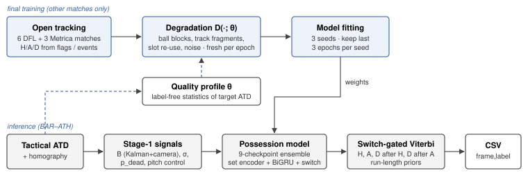
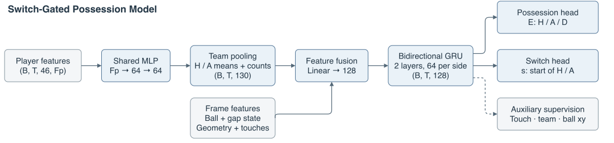
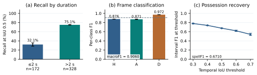

# Learning Ball Possession from Clean Tracking for Noisy Automatic Tracking: a Switch-Gated Possession Model

**TikiData** — Huyen Trang Ngo, Hoang Phuc Ngo, Thanh Long Ly, Khanh Duong Pham, Duc Anh Pham\
More than a Hack 2027, Phase 1 · https://github.com/tlong-ds/tikidata-possession

---

**Abstract.** Our model learns possession from labelled DFL and Metrica matches and transfers to
the target's noisy automatic tracking. We measure the target tracking's failure statistics and
corrupt the clean training tracking to match them. A team-pooled set
encoder and a bidirectional GRU predict per-frame H/A/D and a *change-of-possession* signal, helped
by explicit features of the contest around the ball and of sudden changes in ball motion. A
four-state Viterbi decoder uses the change signal to price team changes and is tuned for `spellF1`.
Before final retraining, the selected configuration scores mean `spellF1` 0.671 and mean
`macroF1` 0.906 across five fixed degraded versions of the Bundesliga match J03WN1. The submission
model is retrained once with the development match added.

---

## 1 Approach



*Figure 1. Training uses only other matches (DFL and Metrica, §2), corrupted to match a label-free
quality profile θ of the target tracking. At inference, stage-1 signals, a 9-checkpoint ensemble and
the decoder run on the target.*

We transfer possession knowledge from labelled matches with clean tracking to the target's
automatic tracking, in which the ball is unseen on 41% of graded frames and
player tracks fragment. The pipeline (Figure 1) has four parts:
1. **Label-free degradation** (§3.1): measure the target tracking's failure statistics and
   corrupt the clean training tracking the same way.
2. **Stage-1 signals** (§3.1): a filtered ball estimate with uncertainty, a dead-ball probability and
   pitch control, computed before the network.
3. **A switch-gated sequence model** (§3.2–3.3): a team-pooled set encoder and BiGRU with a
   change-of-possession head, plus explicit contest and ball-touch features.
4. **A switch-gated Viterbi decoder** (§3.2): turns frame posteriors into possessions, pricing team
   changes with the switch head.

**Why this design.**
- *The ball is often missing*, so the model reads possession cues from player motion. We fit the
  degradation of the training tracking to the target's measured failure statistics.
- *Proximity and pitch control provide complementary cues*: the nearest team is right on 67% of
  live development frames, so the network combines distances and pitch control with player motion.
- *The metric counts possessions*: a model right on most frames still ranks poorly if it splits or
  merges possessions, so changes are predicted explicitly and the decoder is tuned for `spellF1`.

## 2 Training data

**DFL/Sportec open data [1].** Bundesliga matches with 25 Hz corrected tracking
(CC BY 4.0) whose per-frame `BallStatus` and `BallPossession` flags, set by the data provider, have
exactly the semantics of the target ground truth; used as given. The split was fixed before
modelling: five training matches and one development match (J03WN1).

Ten fixed versions of the full J03WN1 match are generated with distinct tracking-degradation
seeds (§3.1). Five are used to choose features, checkpoints and decoder parameters; the remaining
five evaluate the fixed configuration. All share the same match and possession labels.

**Metrica sample data [8].** Three anonymised public matches from another league, used for training only.
Per-frame H/A/D labels are derived from the events by fixed rules (dead from a ball-out or whistle
event to the restart, otherwise the team of the last controlling event), the ball is mapped to the
DFL convention, and the matches are degraded like the DFL ones. Downloads are pinned to a source
commit and verified by SHA-256.

**Final model.** After configuration selection, we retrain with J03WN1 added
(six Bundesliga and three Metrica matches). We average epochs 8, 9 and 10 of seeds 1, 2 and 3,
keeping the decoder settings fixed from selection.

**Reproduction.** Linux, Python 3.12.11. Set the bundle path below and run from the
repository root. The CSV is validated and compared across two CPU thread counts.

```bash
pip install numpy==2.5.4 scipy==1.18.1 \
  pandas==3.1.1 torch==2.15.0
export MTAH_DATA_DIR=/path/to/provided-data
python -m src.submit run --model final_metrica \
  --check-twice --out TikiData.csv
sha256sum TikiData.csv
```

Expected SHA-256: `aca26c78203fdd4ecf233a89754ec4dd2c3bb4db9373625279e85bcc582b59fd`.

The target tracking supplies the noise profile (§3.1) and the ball-touch lag (§3.3).

## 3 Method

### 3.1 Label-free target profiling and degradation

From the target ATD, we compute a quality profile θ:
- ball-visible share, overall and before restarts;
- run lengths of missing and visible ball;
- ball visibility by crowd size and pitch region;
- per-team player counts and their autocorrelation at 1/5/30 s;
- slot occupancy, absence runs and churn;
- missingness and roughness of speeds.

A degradation operator D(·; θ) corrupts a clean DFL half with restart-aware ball dropout in blocks,
player-track fragmentation with slot re-use, position noise and missing speeds. Its strengths are
calibrated on one training match so that the statistics of D(clean) match θ. A new realisation is
drawn every epoch: domain randomisation [5] fitted to measured target statistics.

**Stage-1 signals.** Three hand-built signals, fitted on DFL training matches only, are computed
before the network and used as its inputs:
- **Ball estimate B̂ with uncertainty σ.** A two-way Kalman/RTS smoother [7] with a Mahalanobis
  gate, which separates touches (velocity reset) from spurious detections (rejected). Over long
  gaps, B̂ is fused with the camera centre projected through the homography, because the tactical
  camera follows play.
- **Dead-ball probability.** A logistic model of ball speed, crowding near the ball, distance to
  the nearest player, mean player speed and a soft out-of-bounds term.
- **Pitch control [2, 3] at B̂.** Shrunk towards 0.5 as σ grows.

### 3.2 Switch-Gated Possession Model



*Figure 2. Single-checkpoint architecture. A shared player encoder and team pooling feed a BiGRU
with possession and switch heads. B is batch size, T is sequence length and Fp is the
player-feature dimension.*

The shared player MLP has two 64-unit layers. Masked team mean-pooling (Deep Sets [4]) uses team
membership and includes player counts, making the representation invariant to within-team slot
reassignment. The pooled vectors and frame features are projected to 128 dimensions, then passed
through a 2-layer bidirectional GRU with 64 units per direction. Its switch head predicts the start
of an H or A possession, including restarts.

**Training.**
- *Losses:* cross-entropy on H/A/D, with label smoothing near changes and an extra term within
  ±1 s of a change (weight 0.5); BCE on switch and touch; Huber on ball position.
- *Augmentation:* team swap (with the x-axis mirrored) and a vertical flip.
- *Windows:* 128 steps at stride 2 (≈10 s).
- *Initialisation:* new input columns start at zero, preserving the initial network outputs.
  Configuration training uses a 3-epoch adaptation phase followed by 7 epochs with all weights
  unfrozen.
- *Checkpoint choice:* for each of 3 seeds we keep the 3 epochs with the best `spellF1` on
  the development match, measured *through the decoder*. The 9 checkpoints are averaged.

**Decoder.** Viterbi [6] over {H, A, D<sub>H</sub>, D<sub>A</sub>}; splitting D by the last owner lets
a stoppage remember who had the ball. Emissions are the posteriors *E*<sub>*t*</sub> scaled by λ.
- *Live → D:* hazard *share*<sub>dead</sub>/(*L*<sub>alive</sub>·fps). D runs have expected length
  *L*<sub>dead</sub>. Both are learned on DFL: *L*<sub>alive</sub> = 7.29 s, *L*<sub>dead</sub> =
  24.5 s.
- *H → A:* probability clip(*c*·*ŝ*<sub>*t*</sub><sup>A</sup>, *p*<sub>min</sub>,
  *p*<sub>max</sub>), where *ŝ* is the switch head max-pooled over ±*w* frames; A → H is symmetric.
- *Leaving D for team j:* a restart prior, P(other team) = 0.693, gated by
  *s*<sub>*t*</sub><sup>*j*</sup>.

All decoder parameters are grid-searched on the development match for `spellF1`. The submitted model uses
*c* = 0.02, λ = 0.5 and *w* = 3.

### 3.3 Model inputs

**Base channels.**
- *Per player:* position, velocity, team, presence, offset and distance to B̂, and how long the
  track has existed and will continue to exist.
- *Per frame:*
  - B̂, σ and its source;
  - camera centre and pan;
  - time since and until the ball is seen;
  - for each team, how many players have just vanished or will soon reappear (a crowd vanishing
    from tracking marks a duel);
  - the stage-1 dead-ball and pitch-control probabilities.

**Contest geometry.** Explicit distance features complement team mean pooling.
- *Per team:* the closeness exp(−*d*/5 m) of its nearest and second-nearest player to B̂, the number
  of players within 5 m, and the change of its nearest distance over the past and next 0.4 s.
  These are set to zero when the team's player count or B̂'s source changes, guarding against
  movement artefacts at track gaps.
- *Per player:* closeness to B̂, closeness to the nearest opponent, and approach speed towards B̂.

**Ball touch.** Many missed possessions are a single short touch by the other team between two
possessions of the same team (an intercepted pass that bounces back). The Kalman estimate smooths
such touches away, so we measure them on the *observed* ball. With incoming and outgoing velocities
over a lag *L*, we compute:
- the kick strength |*v*<sub>out</sub> − *v*<sub>in</sub>|, the turn cosine and both speeds;
- for each team, kick × exp(−*d*/1.5 m) to the team's nearest player, max-pooled over ±0.4 s.

**Choosing the ball-motion lag.** The target ball is smoothed: it repeats its previous
coordinate on 0.08% of visible frames, against 48.8% for the DFL ball, and its turns spread over
about 0.4 s. With *L* = 0.2 s, kick peaks occur 4.8 times per minute of visible ball on the target,
against 24.3 on the development match. With *L* = 0.4 s the rates match (19.4 against 21.5), so the
submitted model uses *L* = 0.4 s. This is a label-free statistic of the target, in the same spirit
as §3.1.

**Development ball smoothing.** For target-like sensitivity checks, the visible development
ball is smoothed with a Gaussian of 0.24 s plus 0.4 m of coloured noise. Player tracking and
possession labels are unchanged.

## 4 Results

### 4.1 Evaluation protocol and metrics

The comparison uses the full Bundesliga match J03WN1, kept separate from training during
configuration evaluation. Features, checkpoints and decoder parameters are fixed before scoring
five tracking-degradation versions generated with random seeds distinct from those used for
tuning (§2). All systems are scored on the same five versions, with the same possession labels
and evaluator. All reported experiments were tested on Linux.

H and A denote home- and away-team possession; D denotes a dead ball. We report two metrics.

**spellF1: possession intervals.** A possession interval is a maximal run of H or A, with the
halves kept separate. Predicted and reference intervals of the same team are matched one-to-one,
greedily in decreasing temporal intersection-over-union (IoU). An interval-level F1 is computed
at each IoU threshold in {0.3, 0.4, 0.5, 0.6, 0.7}; `spellF1` is the mean of these five values.

**macroF1: frame labels.** F1 is computed separately for H, A and D over graded frames;
`macroF1` is the unweighted mean of the three class scores. Ground-truth X frames are excluded
from this calculation, and a predicted X on a graded frame counts as a miss.

**Aggregation.** For each metric, we report the mean and sample standard deviation of five
separately scored versions. These summaries quantify tracking-degradation variability within
J03WN1.

### 4.2 Training data and optimisation

For the evaluated configuration, five DFL and three Metrica matches provide 1,139,396 labelled
frames at 25 Hz, or 12.66 hours: 7.94 hours from DFL and 4.72 hours from Metrica. Each original
frame is counted once, before generating tracking corruptions. The H/A/D proportions are
29.7%, 28.1% and 42.2%, respectively. This class imbalance makes the separate class contributions
to `macroF1` useful when interpreting frame classification.

The nine retained checkpoints come from epochs 8/9/10, 7/8/10 and 8/9/10 for seeds 1, 2 and 3,
respectively. They all follow the
initial three-epoch adaptation phase. Their predicted probabilities are averaged before decoding.



*Figure 3. Analysis of the evaluated configuration. (a) Recall at IoU 0.5 for true possessions
lasting at most 2 s (n=172) and longer ones (n=328). (b) H/A/D class F1 scores whose unweighted
mean is macroF1. (c) Possession-interval F1 at each IoU threshold, whose mean is spellF1.
All panels use the same five evaluation versions as Table 1; error bars are sample standard
deviations across those versions.*

### 4.3 Main results

Table 1 compares the Switch-Gated Possession Model with the nearest-player + 50-frame vote
baseline on J03WN1. Both metrics are higher for the model on all five versions.

| system | spellF1 | macroF1 |
|---|---|---|
| Nearest-player | 0.2125 ± 0.0105 | 0.4746 ± 0.0093 |
| **Switch-Gated** | **0.6710 ± 0.0102** | **0.9060 ± 0.0028** |

*Table 1. Mean ± s.d. over five fixed degraded versions of J03WN1, held out from training. The
model uses DFL + Metrica. Results precede final retraining.*

The absolute gains over the baseline are 0.4585 in `spellF1` and 0.4315 in `macroF1`.
Across versions, the model's `spellF1` ranges from 0.6611 to 0.6827 and its `macroF1` from
0.9027 to 0.9092. The small spread measures stability to the sampled tracking corruptions within
this match. The submitted ensemble is subsequently retrained with J03WN1 added, following §2.

### 4.4 What the trained model gets wrong

All diagnostics below use the evaluated model and the same five versions as Table 1.
The mean class F1 scores are 0.8757 for H, 0.8706 for A and 0.9718 for D (Figure 3b).
Their mean gives `macroF1` 0.9060. The high D score raises this average, while both live-team
class scores remain below 0.88.

**Possession recovery.** Interval F1 falls from 0.7787 at IoU 0.3 to 0.5416 at IoU 0.7
(Figure 3c), showing sensitivity to temporal overlap requirements. The model predicts 391.2
possessions on average against 500 true, 21.8% fewer. Of the 500 true possessions, 172 last at
most 2 s. At IoU 0.5, mean recall is 32.1% for these short possessions and 75.1% for longer ones
(Figure 3a).
The high `macroF1` therefore coexists with missed short possession intervals.

**Changes and visibility.** On truly live H/A frames, the fraction labelled with the correct team
is 74.3% within ±1 s of a true team change and 91.0% elsewhere; predicting D on such a frame
counts as wrong. This neighbourhood covers 27.8% of live frames and contains 64.3% of direct
H/A misclassification errors. The same correct-team fraction is 90.3% when the ball is visible
and 78.7% when unseen. These errors concentrate where brief team changes and missing ball
observations make the possession boundary hardest to recover.

## 5 Limitations

- **Evaluation coverage.** Selection and evaluation share J03WN1's events and labels, using
  distinct tracking-degradation seeds. Reported variability concerns tracking errors within one
  match; generalisation across matches remains open.
- **Source–target transfer.** Transfer depends on how well the fitted corruptions represent the
  target's ball motion, missing observations and player-track fragmentation.
- **Long ball gaps.** Reconstruction relies on camera motion and player context; plausible ball
  locations can support different possession assignments.

---

## References

1. M. Bassek et al. An integrated dataset of spatiotemporal and event data in elite soccer. *Scientific Data*, 2025. doi:10.1038/s41597-025-04505-y.
2. W. Spearman. Beyond expected goals. *MIT Sloan SAC*, 2018.
3. J. Fernández, L. Bornn. Wide open spaces. *MIT Sloan SAC*, 2018.
4. M. Zaheer et al. Deep sets. *NeurIPS*, 2017.
5. J. Tobin et al. Domain randomization for transferring deep neural networks from simulation to the real world. *IROS*, 2017.
6. L. Rabiner. A tutorial on hidden Markov models. *Proc. IEEE*, 1989.
7. H. Rauch, F. Tung, C. Striebel. Maximum likelihood estimates of linear dynamic systems. *AIAA J.*, 1965.
8. Metrica Sports. Sample data. https://github.com/metrica-sports/sample-data (commit e706dd5).

## Appendix A — Assets and possession rules

**Missing and noisy tracking.** Target-matched degradation, an uncertainty-aware Kalman/RTS ball
estimate and explicit gap features address tracking failures at training and inference (§3.1–3.3).

**Provided assets.**
- *Tactical ATD:* main input, and the source of θ, the touch lag and the smoothing check.
- *Homography:* camera centre.
- *EPTS metadata:* attack direction per half.
- *Smart Tagging* (Metrica's automatic tagging): the start times of `SET PIECES` tags as label-free
  restart anchors for θ (ball visibility before restarts, §3.1), and the two `Kick Off (Start)` tags
  to place each half's kickoff (possession rules below).
- *Public 5-minute ground truth:* end-to-end pipeline check.

**Possession rules.** The model learns the provider's convention from DFL labels, which matches
the challenge's definition. The decoder adds run-length
priors on top.
- *Loose balls:* possession stays with the last owner until the other team controls the ball; the
  decoder prices a team change through the switch head, so a loose phase without a switch signal
  keeps the previous team.
- *Challenges and deflections:* ownership stays with the previous team through deflections and
  aerial duels until the other team gains control. The ball-touch features supply touch evidence;
  the switch head learns possession changes from the DFL labels.
- *Restarts:* every stoppage is D. The D state remembers the last owner (D<sub>H</sub>/D<sub>A</sub>);
  leaving it, the ball goes to the other team with prior 0.693 (learned on DFL), overridden by the
  switch head of either team.
- *Before a half's kickoff:* graded frames are D. Kickoff is located in the automatic Smart
  Tagging `Kick Off (Start)` window (about 5 s), at the tracked-ball position closest to the centre
  spot. This adjustment applies when the pre-kickoff interval is at least 2 s. On BAR–ATH it sets
  2,449 second-half frames to D and leaves the first half unchanged.
- Every graded frame gets H, A or D; X is used only outside the graded window.
- The organisers' frame-alignment constants map tracking frames to video frames.
